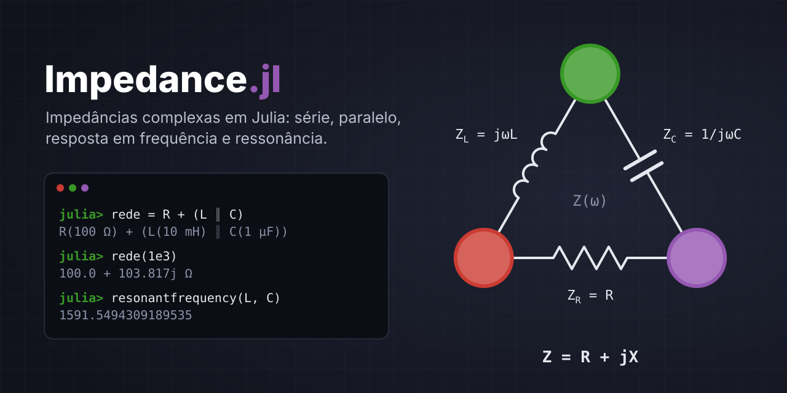

<div align="center">
    
</div>

Pacote Julia para análise de circuitos em corrente alternada com impedâncias complexas.

**Funcionalidades**

- Construtores de impedância **resistiva, indutiva e capacitiva**
- Associação em **série** (`+`) e em **paralelo** (`∥`)
- Acessores `real`, `imag`, `abs`, `angle` (e `resistance`, `reactance`, `admittance`)
- **Divisores** de tensão e de corrente
- **Resposta em frequência** (função de transferência, dB, fase, frequência de corte)
- **Ressonância**, fator de qualidade **Q**, largura de banda e **fator de potência**
- **Coeficiente de reflexão**, VSWR e perda de retorno
- Integração opcional com o pacote **ComplexNumbers** (formas cartesiana/polar)

---

## Requisitos

- Julia **1.10** ou superior

## Instalação

```julia
julia> using Pkg
julia> Pkg.develop(path="/caminho/para/impedance")
julia> using Impedance
```

Para rodar os testes:

```bash
cd impedance
julia --project=. -e 'using Pkg; Pkg.test()'
```

---

## Tutorial

O pacote trabalha em dois níveis:

| Nível | Tipo | Para quê |
|---|---|---|
| Numérico | `ImpedanceValue` | uma impedância **numa frequência** |
| Simbólico | `Element` (`Resistor`, `Inductor`, `Capacitor`, ...) | um **circuito**, avaliável em qualquer frequência |

### 1. Impedâncias numa frequência

```julia
julia> resistive(100)              # R
100.0 + 0.0j Ω

julia> inductive(10e-3, 1e3)       # jωL, f = 1 kHz
0.0 + 62.83185307179586j Ω

julia> capacitive(1e-6, 1e3)       # 1/(jωC)
0.0 - 159.15494309189535j Ω

julia> inductive(10e-3; ω=1000)    # usando ω (rad/s) em vez de f (Hz)
0.0 + 10.0j Ω

julia> impedance(3 + 4im)          # a partir de um número complexo
3 + 4j Ω
```

### 2. Acessores

```julia
julia> Z = impedance(3 + 4im);

julia> real(Z), imag(Z), abs(Z)
(3, 4, 5.0)

julia> angle(Z), angle(Z; degrees=true)
(0.9272952180016122, 53.13010235415598)

julia> resistance(Z), reactance(Z), admittance(Z)
(3, 4, 0.12 - 0.16im)

julia> Complex(Z)
3 + 4im
```

### 3. Série e paralelo

`+` associa em série e `∥` (digite `\parallel<tab>`) em paralelo. Também existem as
funções `series(...)` e `parallel(...)`, que aceitam qualquer número de argumentos.

```julia
julia> resistive(100) + inductive(10e-3, 1e3)
100.0 + 62.83185307179586j Ω

julia> resistive(100) ∥ resistive(100)
50.0 + 0.0j Ω

julia> 100 ∥ 220                   # também funciona com números
68.75

julia> parallel(resistive(100), resistive(100), resistive(100))
33.333333333333336 + 0.0j Ω
```

> **Atenção — precedência de `∥`.** Para o Julia, `∥` é um operador de *comparação*
> (como `<`). Por isso:
>
> - `R + L ∥ C` significa `(R + L) ∥ C` → escreva `R + (L ∥ C)`;
> - `R ∥ L ∥ C` é encadeado como `(R ∥ L) && (L ∥ C)` e dá erro → use `parallel(R, L, C)` ou `(R ∥ L) ∥ C`;
> - `Z1 ∥ Z2 ≈ Z3` também encadeia → escreva `(Z1 ∥ Z2) ≈ Z3`.

### 4. Circuitos (elementos simbólicos)

Elementos guardam os valores dos componentes e podem ser avaliados em qualquer
frequência com `impedance(rede, f)` ou simplesmente `rede(f)`:

```julia
julia> R, L, C = Resistor(100), Inductor(10e-3), Capacitor(1e-6);

julia> rede = R + (L ∥ C)
R(100 Ω) + (L(10 mH) ∥ C(1 µF))

julia> rede(1e3)
100.0 + 103.81726746840584j Ω

julia> impedance(rede; ω=2π*1e3)
100.0 + 103.81726746840584j Ω
```

Valores numéricos podem ser misturados com elementos (viram impedâncias fixas):

```julia
julia> R + impedance(0 + 50im)
R(100 Ω) + Z(0 + 50j Ω)
```

### 5. Divisores de tensão e de corrente

```julia
julia> voltagedivider(10, resistive(1e3), resistive(2e3))     # tensão sobre Z2
6.666666666666666 + 0.0im

julia> currentdivider(1, resistive(1), resistive(3))          # corrente em Z1
0.75 + 0.0im

julia> voltagedivider(10, [resistive(1), resistive(2), resistive(2)])  # n impedâncias em série
3-element Vector{ComplexF64}:
 2.0 + 0.0im
 4.0 + 0.0im
 4.0 + 0.0im

julia> voltagedivider(1, Resistor(1e3), Capacitor(1e-6), 159.15)  # com elementos + frequência
0.50001552942234 - 0.499999999758837im
```

Lei de Ohm: `voltage(Z, I)` e `current(V, Z)` (ou `V / Z`).

### 6. Resposta em frequência

```julia
julia> R, C = Resistor(1e3), Capacitor(1e-6);

julia> fc = cutofffrequency(R, C)          # 1/(2πRC)
159.15494309189535

julia> H = transfer(R, C, fc)              # passa-baixas RC: Vout sobre C
0.5 - 0.5im

julia> db(H), phase(H; degrees=true)
(-3.0102999566398116, -45.0)

julia> fs = logfreqs(10, 1e5, 200);        # frequências log-espaçadas

julia> H = frequencyresponse(R, C, fs);    # Vector{ComplexF64}

julia> Z = frequencyresponse(R + C, fs);   # impedância da rede em cada f
```

Para um diagrama de Bode, plote `db.(H)` e `phase.(H; degrees=true)` contra `fs`.

### 7. Ressonância e fatores

```julia
julia> R, L, C = Resistor(10), Inductor(1e-3), Capacitor(1e-6);

julia> resonantfrequency(L, C)             # 1/(2π√(LC))
5032.921210448703

julia> resonantfrequencies(R + L + C; fmax=1e6)   # busca numérica em qualquer rede
1-element Vector{Float64}:
 5032.921210448692

julia> qfactor(R, L, C)                    # série: (1/R)√(L/C)
3.1622776601683795

julia> qfactor(R, L, C; topology=:parallel)
0.3162277660168379

julia> bandwidth(R, L, C)                  # f₀/Q
1591.5494309189532

julia> Z = resistive(3) + impedance(4im);

julia> powerfactor(Z), pfnature(Z)         # cos φ e natureza da carga
(0.6000000000000001, :lagging)
```

### 8. Coeficiente de reflexão

```julia
julia> Γ = reflectioncoefficient(resistive(75), 50)   # (ZL − Z0)/(ZL + Z0)
0.2 + 0.0im

julia> vswr(Γ), returnloss(Γ)
(1.5, 13.979400086720375)

julia> reflectioncoefficient(Resistor(75), 1e6, 50)   # elemento + frequência
0.2 + 0.0im
```

### 9. Integração com ComplexNumbers

Com os dois pacotes carregados, uma extensão permite converter entre
`ImpedanceValue` e `ComplexNumber`, aproveitando as formas cartesiana e polar:

```julia
julia> using Impedance, ComplexNumbers

julia> z = ComplexNumber(resistive(3) + impedance(4im))
3.0 + 4.0i

julia> tostring(z; form=:polar, degrees=true)
"5.0∠53.1301°"

julia> impedance(ComplexNumber(1, -2))
1 - 2j Ω
```

---

## Referência rápida

| Categoria | Funções |
|---|---|
| Construtores | `resistive`, `inductive`, `capacitive`, `impedance`, `ImpedanceValue` |
| Elementos | `Resistor`, `Inductor`, `Capacitor`, `Fixed`, `Series`, `Parallel` |
| Associação | `+`, `∥`, `series`, `parallel` |
| Acessores | `real`, `imag`, `abs`, `angle`, `phase`, `conj`, `resistance`, `reactance`, `admittance` |
| Ohm | `voltage`, `current` |
| Divisores | `voltagedivider`, `currentdivider` |
| Frequência | `frequencyresponse`, `transfer`, `db`, `logfreqs`, `cutofffrequency` |
| Ressonância | `resonantfrequency`, `resonantfrequencies`, `qfactor`, `bandwidth` |
| Potência | `powerfactor`, `pfnature` |
| Linhas | `reflectioncoefficient`, `vswr`, `returnloss` |
