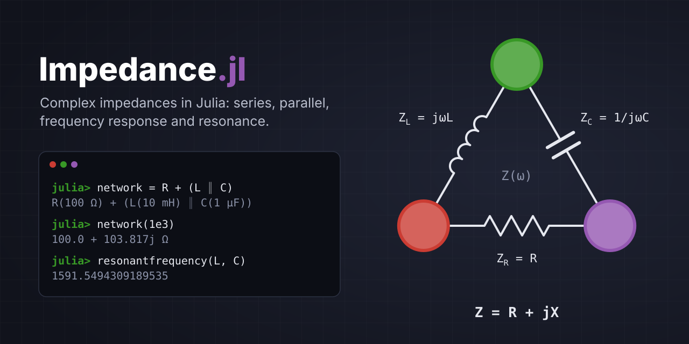
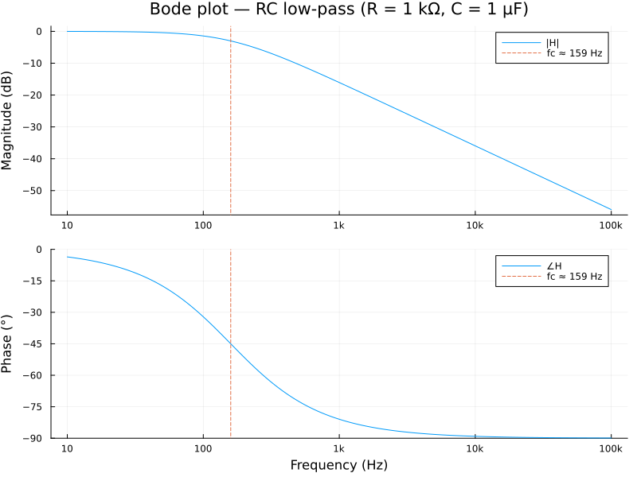

<div align="center">
    
</div>

Julia package for AC circuit analysis with complex impedances.

**Features**

- **Resistive, inductive and capacitive** impedance constructors
- **Series** (`+`) and **parallel** (`∥`) connection
- Accessors `real`, `imag`, `abs`, `angle` (and `resistance`, `reactance`, `admittance`)
- Voltage and current **dividers**
- **Frequency response** (transfer function, dB, phase, cutoff frequency)
- **Resonance**, quality factor **Q**, bandwidth and **power factor**
- **Reflection coefficient**, VSWR and return loss
- Optional integration with the **ComplexNumbers** package (Cartesian/polar forms)

---

## Requirements

- Julia **1.10** or later

## Installation

```julia
julia> using Pkg
julia> Pkg.develop(path="/path/to/impedance")
julia> using Impedance
```

To run the tests:

```bash
cd impedance
julia --project=. -e 'using Pkg; Pkg.test()'
```

---

## Tutorial

The package works at two levels:

| Level | Type | Used for |
|---|---|---|
| Numeric | `ImpedanceValue` | an impedance **at one frequency** |
| Symbolic | `Element` (`Resistor`, `Inductor`, `Capacitor`, ...) | a **circuit**, evaluable at any frequency |

### 1. Impedances at a single frequency

```julia
julia> resistive(100)              # R
100.0 + 0.0j Ω

julia> inductive(10e-3, 1e3)       # jωL, f = 1 kHz
0.0 + 62.83185307179586j Ω

julia> capacitive(1e-6, 1e3)       # 1/(jωC)
0.0 - 159.15494309189535j Ω

julia> inductive(10e-3; ω=1000)    # using ω (rad/s) instead of f (Hz)
0.0 + 10.0j Ω

julia> impedance(3 + 4im)          # from a complex number
3 + 4j Ω
```

### 2. Accessors

```julia
julia> Z = impedance(3 + 4im);

julia> real(Z), imag(Z), abs(Z)
(3, 4, 5.0)

julia> angle(Z), angle(Z; degrees=true)
(0.9272952180016122, 53.13010235415598)

julia> resistance(Z), reactance(Z), admittance(Z)
(3, 4, 0.12 - 0.16im)

julia> Complex(Z)
3 + 4im
```

### 3. Series and parallel

`+` connects in series and `∥` (type `\parallel<tab>`) in parallel. The functions
`series(...)` and `parallel(...)` also exist and accept any number of arguments.

```julia
julia> resistive(100) + inductive(10e-3, 1e3)
100.0 + 62.83185307179586j Ω

julia> resistive(100) ∥ resistive(100)
50.0 + 0.0j Ω

julia> 100 ∥ 220                   # also works with plain numbers
68.75

julia> parallel(resistive(100), resistive(100), resistive(100))
33.333333333333336 + 0.0j Ω
```

> **Warning — precedence of `∥`.** In Julia, `∥` is a *comparison* operator
> (like `<`). Therefore:
>
> - `R + L ∥ C` means `(R + L) ∥ C` → write `R + (L ∥ C)`;
> - `R ∥ L ∥ C` is chained as `(R ∥ L) && (L ∥ C)` and fails → use `parallel(R, L, C)` or `(R ∥ L) ∥ C`;
> - `Z1 ∥ Z2 ≈ Z3` also chains → write `(Z1 ∥ Z2) ≈ Z3`.

### 4. Circuits (symbolic elements)

Elements store the component values and can be evaluated at any frequency with
`impedance(network, f)` or simply `network(f)`:

```julia
julia> R, L, C = Resistor(100), Inductor(10e-3), Capacitor(1e-6);

julia> network = R + (L ∥ C)
R(100 Ω) + (L(10 mH) ∥ C(1 µF))

julia> network(1e3)
100.0 + 103.81726746840584j Ω

julia> impedance(network; ω=2π*1e3)
100.0 + 103.81726746840584j Ω
```

Numeric values can be mixed with elements (they become fixed impedances):

```julia
julia> R + impedance(0 + 50im)
R(100 Ω) + Z(0 + 50j Ω)
```

### 5. Voltage and current dividers

```julia
julia> voltagedivider(10, resistive(1e3), resistive(2e3))     # voltage across Z2
6.666666666666666 + 0.0im

julia> currentdivider(1, resistive(1), resistive(3))          # current through Z1
0.75 + 0.0im

julia> voltagedivider(10, [resistive(1), resistive(2), resistive(2)])  # n impedances in series
3-element Vector{ComplexF64}:
 2.0 + 0.0im
 4.0 + 0.0im
 4.0 + 0.0im

julia> voltagedivider(1, Resistor(1e3), Capacitor(1e-6), 159.15)  # with elements + frequency
0.50001552942234 - 0.499999999758837im
```

Ohm's law: `voltage(Z, I)` and `current(V, Z)` (or `V / Z`).

### 6. Frequency response

```julia
julia> R, C = Resistor(1e3), Capacitor(1e-6);

julia> fc = cutofffrequency(R, C)          # 1/(2πRC)
159.15494309189535

julia> H = transfer(R, C, fc)              # RC low-pass: Vout across C
0.5 - 0.5im

julia> db(H), phase(H; degrees=true)
(-3.0102999566398116, -45.0)

julia> fs = logfreqs(10, 1e5, 200);        # log-spaced frequencies

julia> H = frequencyresponse(R, C, fs);    # Vector{ComplexF64}

julia> Z = frequencyresponse(R + C, fs);   # network impedance at each f
```

#### Bode plot

A Bode plot shows `db.(H)` and `phase.(H; degrees=true)` against `fs` on a logarithmic
frequency axis. The code below draws it with [Plots.jl](https://docs.juliaplots.org),
which is not a dependency of this package; install it with `using Pkg; Pkg.add("Plots")`.

```julia
using Impedance, Plots

R, C = Resistor(1e3), Capacitor(1e-6)
fs = logfreqs(10, 1e5, 200)
H = frequencyresponse(R, C, fs)
fc = cutofffrequency(R, C)

ticks = (exp10.(1:5), ["10", "100", "1k", "10k", "100k"])

mag = plot(fs, db.(H); xscale=:log10, xticks=ticks, ylabel="Magnitude (dB)",
           label="|H|", title="Bode plot — RC low-pass (R = 1 kΩ, C = 1 µF)")
vline!(mag, [fc]; linestyle=:dash, label="fc ≈ 159 Hz")

pha = plot(fs, phase.(H; degrees=true); xscale=:log10, xticks=ticks,
           xlabel="Frequency (Hz)", ylabel="Phase (°)", ylims=(-90, 0),
           yticks=-90:15:0, label="∠H")
vline!(pha, [fc]; linestyle=:dash, label="fc ≈ 159 Hz")

plot(mag, pha; layout=(2, 1), size=(800, 600), background_color=:white)
```

At the cutoff frequency the gain is −3 dB and the phase is −45°. Above it the gain
falls by 20 dB per decade and the phase approaches −90°.



The figure is generated by [`scripts/bode.jl`](scripts/bode.jl)
(`julia --project=scripts scripts/bode.jl`).

### 7. Resonance and factors

```julia
julia> R, L, C = Resistor(10), Inductor(1e-3), Capacitor(1e-6);

julia> resonantfrequency(L, C)             # 1/(2π√(LC))
5032.921210448703

julia> resonantfrequencies(R + L + C; fmax=1e6)   # numerical search on any network
1-element Vector{Float64}:
 5032.921210448692

julia> qfactor(R, L, C)                    # series: (1/R)√(L/C)
3.1622776601683795

julia> qfactor(R, L, C; topology=:parallel)
0.3162277660168379

julia> bandwidth(R, L, C)                  # f₀/Q
1591.5494309189532

julia> Z = resistive(3) + impedance(4im);

julia> powerfactor(Z), pfnature(Z)         # cos φ and load nature
(0.6000000000000001, :lagging)
```

### 8. Reflection coefficient

```julia
julia> Γ = reflectioncoefficient(resistive(75), 50)   # (ZL − Z0)/(ZL + Z0)
0.2 + 0.0im

julia> vswr(Γ), returnloss(Γ)
(1.4999999999999998, 13.979400086720375)

julia> reflectioncoefficient(Resistor(75), 1e6, 50)   # element + frequency
0.2 + 0.0im
```

### 9. ComplexNumbers integration

With both packages loaded, an extension converts between `ImpedanceValue` and
`ComplexNumber`, giving access to the Cartesian and polar forms:

```julia
julia> using Impedance, ComplexNumbers

julia> z = ComplexNumber(resistive(3) + impedance(4im))
3.0 + 4.0i

julia> tostring(z; form=:polar, degrees=true)
"5.0∠53.1301°"

julia> impedance(ComplexNumber(1, -2))
1 - 2j Ω
```

---

## Quick reference

| Category | Functions |
|---|---|
| Constructors | `resistive`, `inductive`, `capacitive`, `impedance`, `ImpedanceValue` |
| Elements | `Resistor`, `Inductor`, `Capacitor`, `Fixed`, `Series`, `Parallel` |
| Connection | `+`, `∥`, `series`, `parallel` |
| Accessors | `real`, `imag`, `abs`, `angle`, `phase`, `conj`, `resistance`, `reactance`, `admittance` |
| Ohm | `voltage`, `current` |
| Dividers | `voltagedivider`, `currentdivider` |
| Frequency | `frequencyresponse`, `transfer`, `db`, `logfreqs`, `cutofffrequency` |
| Resonance | `resonantfrequency`, `resonantfrequencies`, `qfactor`, `bandwidth` |
| Power | `powerfactor`, `pfnature` |
| Lines | `reflectioncoefficient`, `vswr`, `returnloss` |
